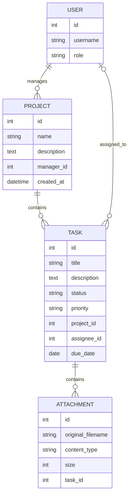

# Task Tracker

Базовий каркас системи керування проєктами та задачами
## Запуск локально

Потрібен Python 3.12 або новіший.

```bash
python3 -m venv .venv
source .venv/bin/activate
python -m pip install -r requirements-dev.txt
python manage.py migrate
python manage.py runserver
```

Службова перевірка доступна за адресою `GET http://127.0.0.1:8000/health` і повертає:

```json
{"status": "ok"}
```

Для створення адміністратора виконайте `python manage.py createsuperuser`. Локальне значення секретного ключа призначене лише для розробки; перед розгортанням задайте змінну середовища `DJANGO_SECRET_KEY` і вимкніть режим налагодження через `DJANGO_DEBUG=false`.

## Структура

- `config/` — налаштування Django, маршрути та endpoint перевірки стану.
- `accounts/` — користувачі та їхні ролі.
- `projects/` — моделі проєктів і задач, репозиторний та сервісний шари.

## Модель даних



## REST API

Колекції та деталі проєктів і задач доступні за адресами:

- `/api/projects/` і `/api/projects/{id}/`
- `/api/tasks/` і `/api/tasks/{id}/`

Для обох ресурсів доступні `GET`, `POST`, `PUT`, `PATCH` і `DELETE`. Щоб створити проєкт, передайте `manager_id`; для задачі — `project_id` і за потреби `assignee_id`. Відповіді містять вкладені дані менеджера, проєкту та виконавця.

Списки повертаються сторінками по 20 записів. Номер сторінки задається параметром `page`. Фільтри:

- Проєкти: `name`, `manager`, `created_after`, `created_before`.
- Задачі: `project`, `status`, `priority`, `assignee`, `due_after`, `due_before`.

Сортування задається параметром `ordering`; префікс `-` сортує у зворотному порядку. Наприклад: `/api/tasks/?status=in_progress&ordering=-due_date&page=2`.

Помилки API повертаються у форматі `application/problem+json` за RFC 7807. Колекції використовують `select_related` для завантаження пов'язаних даних без N+1-запитів.

## Документація API та вкладення

- Swagger UI: `http://127.0.0.1:8000/api/docs/`.
- OpenAPI JSON: `http://127.0.0.1:8000/api/schema/?format=json`.
- Список і завантаження файлів задачі: `GET` і `POST /api/tasks/{id}/attachments/`.
- Отримання файла: `GET /api/tasks/{id}/attachments/{attachment_id}/download/`.

Файл передається як `multipart/form-data` у полі `file`. Дозволені PDF, PNG, JPEG і UTF-8 TXT розміром до 5 МБ; перевіряються розширення, MIME-тип і вміст. Файли зберігаються у `MEDIA_ROOT` (за замовчуванням — каталог `media/`), а при видаленні задачі вкладення й відповідні файли видаляються.

## Перевірки коду

```bash
ruff check .
ruff format --check .
python manage.py test
```

Інтеграційні тести використовують окрему SQLite-базу `test_db.sqlite3`, яка створюється Django під час запуску тестів.
