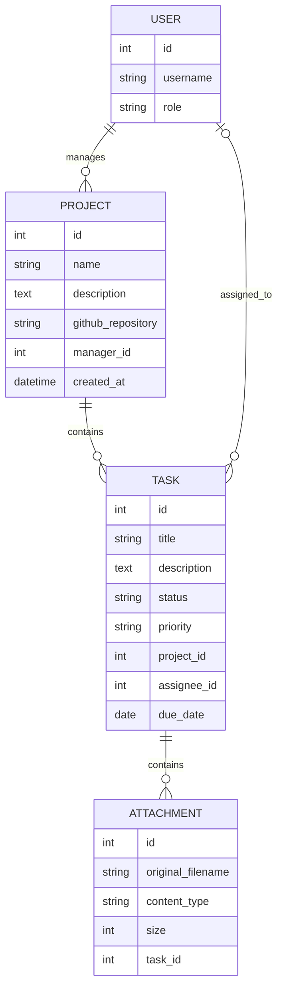

# Task Tracker

Базовий каркас системи керування проєктами та задачами
## Запуск локально

Потрібен Python 3.12 або новіший.

```bash
python3 -m venv .venv
source .venv/bin/activate
python -m pip install -r requirements-dev.txt
cp .env.example .env
python -c 'import secrets; print(secrets.token_urlsafe(50))'
```

Скопіювати згенерований ключ у поле `DJANGO_SECRET_KEY` файлу `.env`, потім завантаж змінні та запусти застосунок:

```bash
source .env
python manage.py migrate
python manage.py runserver
```

Файл `.env` ігнорується Git. `DJANGO_DEBUG`, `DJANGO_ALLOWED_HOSTS`, `DJANGO_DB_PATH`, `GITHUB_API_TIMEOUT_SECONDS` і `GITHUB_CACHE_TTL_SECONDS` налаштовуються через змінні середовища. Для production встанови `DJANGO_DEBUG=false`, задай секретний ключ і список доменів у `DJANGO_ALLOWED_HOSTS`. Без ключа або списку доменів при вимкненому debug застосунок не запуститься.

Службова перевірка доступна за адресою `GET http://127.0.0.1:8000/health` і повертає:

```json
{"status": "ok"}
```

Для створення адміністратора виконайте `python manage.py createsuperuser`.

## Структура

- `config/` — налаштування Django, маршрути та endpoint перевірки стану.
- `accounts/` — користувачі та їхні ролі.
- `projects/` — моделі проєктів і задач, репозиторний та сервісний шари.

## Модель даних



## REST API

Колекції та деталі проєктів і задач доступні за адресами:

- `/api/projects/` і `/api/projects/{id}/`
- `/api/tasks/` і `/api/tasks/{id}/`

Для обох ресурсів доступні `GET`, `POST`, `PUT`, `PATCH` і `DELETE`. Щоб створити проєкт, передайте `manager_id`; для задачі — `project_id` і за потреби `assignee_id`. Відповіді містять вкладені дані менеджера, проєкту та виконавця.

Списки повертаються сторінками по 20 записів. Номер сторінки задається параметром `page`. Фільтри:

- Проєкти: `name`, `manager`, `created_after`, `created_before`.
- Задачі: `project`, `status`, `priority`, `assignee`, `due_after`, `due_before`.

Сортування задається параметром `ordering`; префікс `-` сортує у зворотному порядку. Наприклад: `/api/tasks/?status=in_progress&ordering=-due_date&page=2`.

Помилки API повертаються у форматі `application/problem+json` за RFC 7807. Колекції використовують `select_related` для завантаження пов'язаних даних без N+1-запитів.

## Фонова синхронізація GitHub

У проєкту можна задати публічний GitHub-репозиторій у форматі `owner/repository` через поле `github_repository`. Виклик `POST /api/projects/{id}/repository-sync/` одразу створює job у SQLite й повертає `202 Accepted`; запит не очікує відповіді GitHub. Стан job доступний через `GET /api/repository-sync-jobs/{job_id}/`, а збережені коміти — через `GET /api/projects/{id}/commits/`.

Чергу зберігає база даних; брокер повідомлень не використовується. Для обробки job запусти worker окремим процесом у другому терміналі:

```bash
cd /Users/anatolijkiselov/TaskTracker
source .venv/bin/activate
source .env
python manage.py process_repository_sync_jobs
```

GitHub API-клієнт використовує стандартну бібліотеку Python, має timeout `GITHUB_API_TIMEOUT_SECONDS` і кешує успішну відповідь на `GITHUB_CACHE_TTL_SECONDS`. Мережеві помилки, timeout, неуспішні HTTP-відповіді та некоректний JSON позначають job як `failed`; помилка одного job не зупиняє worker. Синхронізація зараз працює з публічними репозиторіями та завантажує до 20 останніх комітів.

## Індекс запитів задач

Частий запит списку задач фільтрує за проєктом і статусом та сортує за терміном: `/api/tasks/?project=1&status=todo&ordering=due_date`. До етапу оптимізації SQLite використовувала окремий індекс зовнішнього ключа проєкту й тимчасове сортування. Міграція додає складений індекс `task_proj_status_due_id_idx` на `(project_id, status, due_date, id)`. Інтеграційний тест перевіряє план ORM-запиту через `EXPLAIN`.

Щоб відтворити порівняння плану й часу на 100 000 синтетичних рядків у тимчасовій in-memory SQLite-базі, виконай:

```bash
python manage.py analyze_task_query --rows 100000 --samples 15
```

Один вимір у середовищі розробки: без індексу — повне сканування таблиці й тимчасове сортування, медіана `2.089 ms`; зі складеним індексом — пошук через індекс, медіана `0.008 ms` (приблизно `260x` швидше). Фактичні значення залежать від середовища; команда повторює вимір і показує обидва плани.

## Документація API та вкладення

- Swagger UI: `http://127.0.0.1:8000/api/docs/`.
- OpenAPI JSON: `http://127.0.0.1:8000/api/schema/?format=json`.
- Список і завантаження файлів задачі: `GET` і `POST /api/tasks/{id}/attachments/`.
- Отримання файла: `GET /api/tasks/{id}/attachments/{attachment_id}/download/`.

Файл передається як `multipart/form-data` у полі `file`. Дозволені PDF, PNG, JPEG і UTF-8 TXT розміром до 5 МБ; перевіряються розширення, MIME-тип і вміст. Файли зберігаються у `MEDIA_ROOT` (за замовчуванням — каталог `media/`), а при видаленні задачі вкладення й відповідні файли видаляються.

## Перевірки коду

```bash
ruff check .
ruff format --check .
python manage.py test
python manage.py analyze_task_query
```

Інтеграційні тести використовують окрему SQLite-базу `test_db.sqlite3`, яка створюється Django під час запуску тестів.
