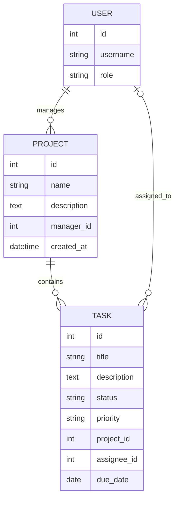

# Task Tracker

Базовий каркас системи керування проєктами та задачами
## Запуск локально

Потрібен Python 3.12 або новіший.

```bash
python3 -m venv .venv
source .venv/bin/activate
python -m pip install -r requirements-dev.txt
python manage.py migrate
python manage.py runserver
```

Службова перевірка доступна за адресою `GET http://127.0.0.1:8000/health` і повертає:

```json
{"status": "ok"}
```

Для створення адміністратора виконайте `python manage.py createsuperuser`. Локальне значення секретного ключа призначене лише для розробки; перед розгортанням задайте змінну середовища `DJANGO_SECRET_KEY` і вимкніть режим налагодження через `DJANGO_DEBUG=false`.

## Структура

- `config/` — налаштування Django, маршрути та endpoint перевірки стану.
- `accounts/` — користувачі та їхні ролі.
- `projects/` — моделі проєктів і задач, репозиторний та сервісний шари.

## Модель даних



## Перевірки коду

```bash
ruff check .
ruff format --check .
```
